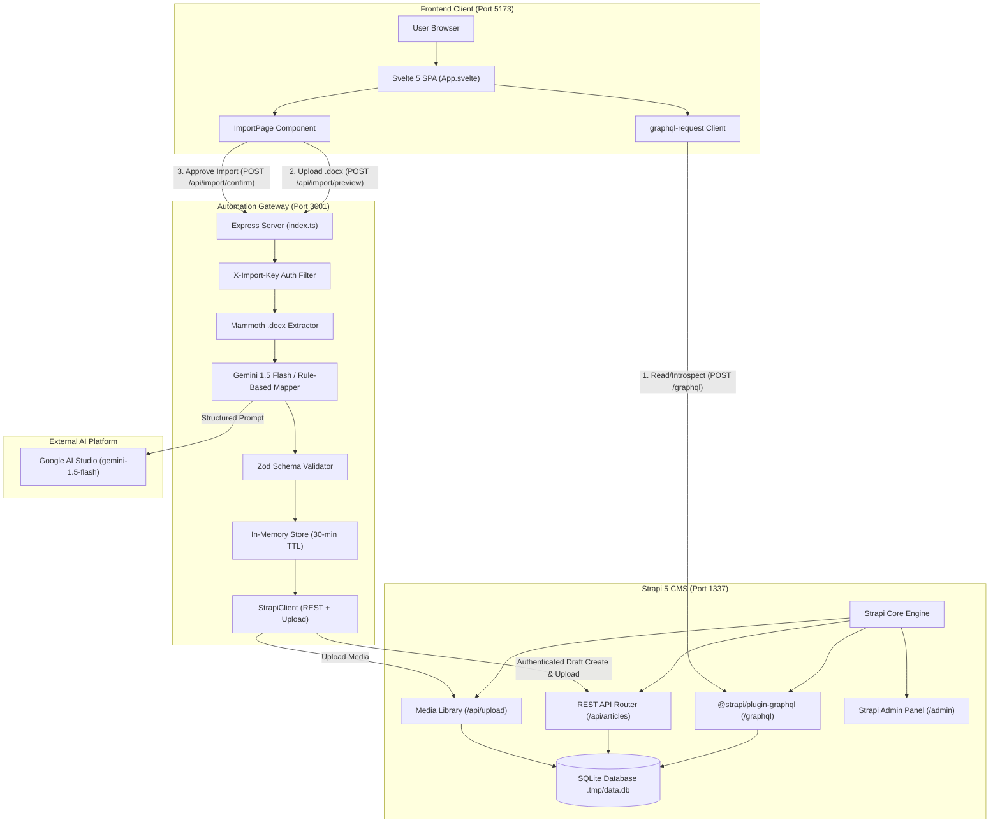
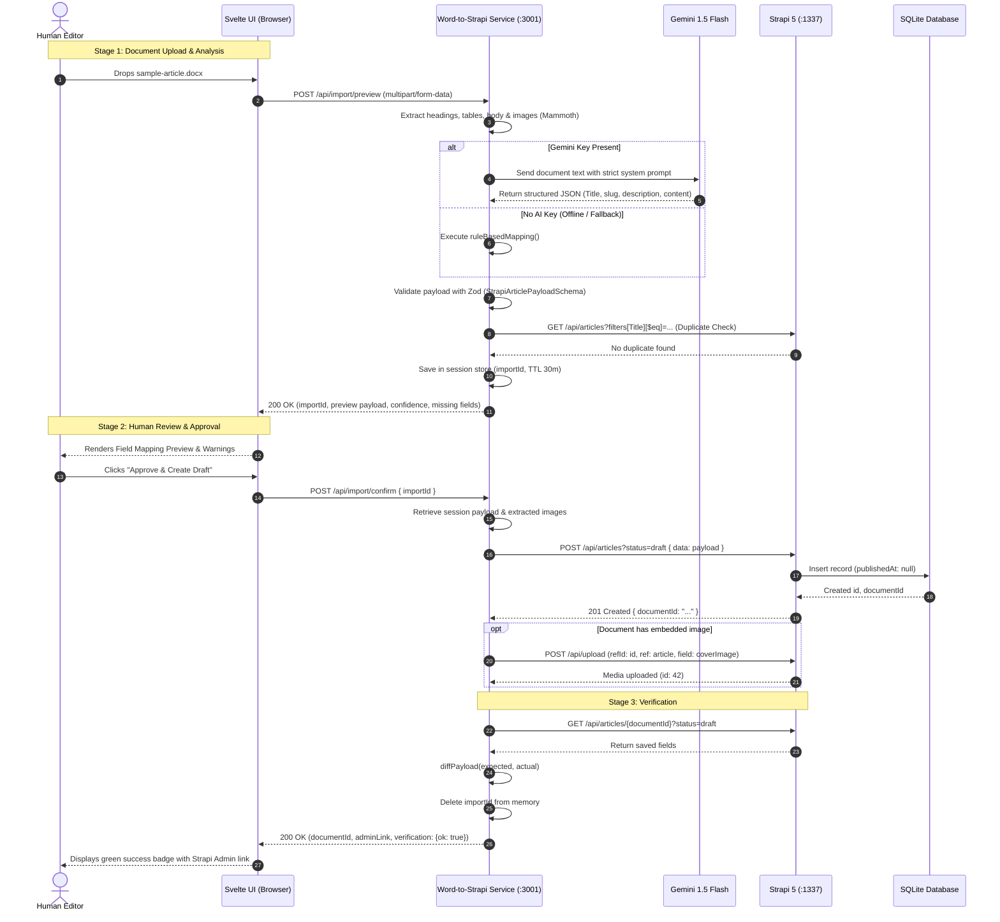
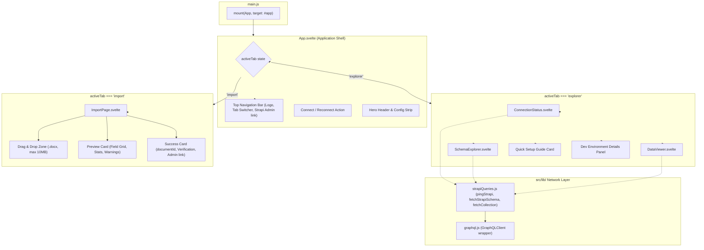
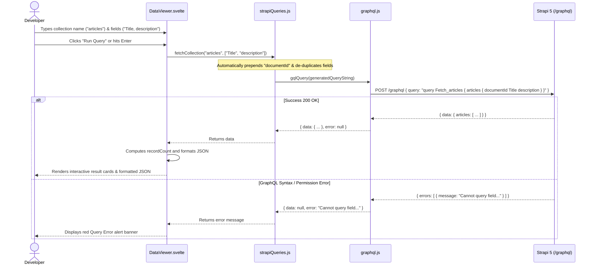

# 03 — Overall System Architecture & Data Flow

## 1. Architectural Philosophy

The system adheres to **Clean Architecture** principles and the **Principle of Least Privilege**:
1. **Frontend Isolation**: The browser is treated as a public, untrusted execution environment. It possesses no administrative tokens for Strapi and no Gemini AI keys.
2. **Backend Microservice as Secure Gateway**: Complex, compute-heavy, and sensitive tasks (parsing `.docx` binary files, communicating with Google Gemini AI, managing Strapi write credentials) are quarantined inside `word-to-strapi-service`.
3. **Decoupled Data Reads vs Writes**:
   - **Reads** occur directly between the Svelte frontend and Strapi 5's GraphQL API (`/graphql`) for maximum performance, selective field querying, and schema introspection.
   - **Writes** (Content Creation) strictly occur via the backend service through Strapi 5's authenticated REST API (`/api/articles?status=draft`) and Media Upload API (`/api/upload`).
4. **Draft Safety**: The system enforces that automated processes can only create draft records (`publishedAt: null`). Only an authenticated editor in the Strapi Admin UI can publish articles to production.

---

## 2. Mermaid Diagrams

### Diagram 1: High-Level System Architecture

---

### Diagram 2: End-to-End Request and Data Flow

---

### Diagram 3: Frontend Component & State Architecture

---

### Diagram 4: Runtime Flow — Live GraphQL Query Execution

