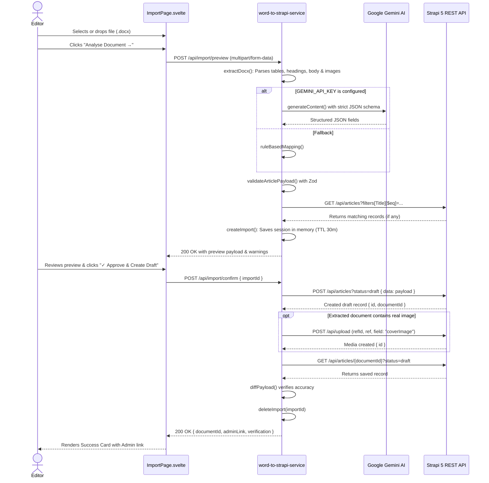

# 09 — Step-by-Step Runtime Workflows

This document traces the exact sequence of execution for the primary runtime workflows in the application.

---

## Workflow 1: Starting the Multi-Tier Development Environment

To run the complete system, three processes run concurrently in separate terminals:

```
Terminal 1: Strapi 5 (Port 1337)
cd my-strapi
npm run develop
└── Starts Strapi on http://localhost:1337 with auto-reload and SQLite database at .tmp/data.db

Terminal 2: Word-to-Strapi Service (Port 3001)
cd word-to-strapi-service
npm run dev  (or: npm run build && npm start)
└── Starts Express on http://localhost:3001 using ts-node or compiled dist/index.js

Terminal 3: Svelte Frontend (Port 5173)
cd . (workspace root)
npm run dev
└── Starts Vite dev server on http://localhost:5173 with hot-module reloading (HMR)
```

---

## Workflow 2: Frontend Boot and Strapi Auto-Connection

1. **Browser Navigation**: User opens `http://localhost:5173`.
2. **HTML & JS Load**: `index.html` loads; `src/main.js` executes `mount(App, { target: document.getElementById('app') })`.
3. **App Mount (`onMount`)**: `App.svelte` executes `connect()`.
4. **Latency Measurement**:
   - `connectionStatus` is set to `'loading'`.
   - `start = performance.now()`.
   - Calls `pingStrapi()`, executing `query Ping { __typename }` via `client.request()` in `src/lib/graphql.js`.
   - `elapsed = Math.round(performance.now() - start)`.
5. **State Transition**:
   - If ping succeeds: `connectionStatus = 'connected'`, `responseTime = elapsed`, `hasConnected = true`.
   - `ConnectionStatus.svelte` renders a glowing green dot with response time badge.
6. **Schema Introspection**:
   - Calls `fetchStrapiSchema()`, executing `INTROSPECTION_QUERY`.
   - `schemaFields` updates with available fields from `__schema.queryType.fields`.
   - `SchemaExplorer.svelte` filters out internal Strapi fields and renders collection badges.

---

## Workflow 3: Live Data Query Execution via GraphQL

1. **User Action**: Editor opens the GraphQL Explorer tab, enters collection name (e.g. `articles`), and specifies comma-separated fields (e.g. `Title, description, slug`).
2. **Query Assembly**: `DataViewer.svelte` calls `fetchCollection('articles', ['Title', 'description', 'slug'])`.
3. **De-duplication**: `fetchCollection()` prepends `documentId`, filters duplicates, and formats the query string:
   ```graphql
   query Fetch_articles {
     articles {
       documentId
       Title
       description
       slug
     }
   }
   ```
4. **Execution**: `gqlQuery()` sends the POST request to `http://localhost:1337/graphql`.
5. **Rendering**:
   - `loading` turns false.
   - Total records are counted via `reduce()`.
   - Each item in `result.articles` is rendered as an interactive card displaying field values.
   - Formatted JSON is displayed in a collapsible code block.

---

## Workflow 4: Word Document Import, AI Mapping, and Draft Creation



---

## Workflow 5: Duplicate Conflict Resolution

1. If a document has the title `"The Future of Renewable Energy"`, and an article draft with that title already exists in Strapi:
2. **During Preview**: `findByTitle()` detects the existing entry. The preview card displays an amber warning badge:
   `⚠ Duplicate found (documentId: v7ptey5dt0h1rydhnre4u2b4)`.
3. **During Confirmation**: If the user approves anyway, `confirm` executes a second check. If the duplicate still exists, the server responds with HTTP 409 Conflict:
   ```json
   {
     "error": "Duplicate: an article with this Title already exists as draft.",
     "documentId": "v7ptey5dt0h1rydhnre4u2b4",
     "adminLink": "http://localhost:1337/admin/content-manager/collection-types/api::article.article/v7ptey5dt0h1rydhnre4u2b4"
   }
   ```
4. The frontend catches the 409 error and informs the user to either modify the title or edit the existing draft in Strapi Admin.
